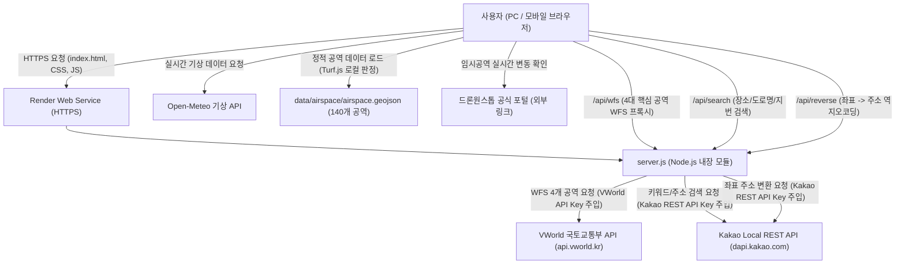

# 🚁 드론 안전 체크 (Drone Safety Check) — 프로젝트 마스터 명세서

> 문서 버전: 1.4.0 (STEP 3.28 기준) 
> 최종 갱신일: 2026-10-19

---

## 1. 프로젝트 비전 및 목표

* **목표**: 비행 전 드론 조종자(취미용, 사업용, 농업용 등)가 복잡한 인허가 규정과 비행 가능 여부를 한 번의 위치 선택으로 즉시 판정받을 수 있는 초경량 고성능 웹 서비스.
* **핵심 가치**:
  * 외부 설치 프로그램 없이 브라우저(PC/모바일)에서 즉시 동작
  * 국토교통부 브이월드(VWorld) 4대 핵심 공역(140개) 로컬 Turf 판정 및 오픈 기상 데이터 실시간 연동
  * 안전한 프록시 구조로 Kakao 및 VWorld API Key 브라우저 노출 원천 방지
  * Zero-Dependency 순수 Node.js로 가볍고 신속한 배포
  * 클라우드 호스팅(Render) 환경에서도 중단 없는 고신뢰 검색 및 역지오코딩 제공

---

## 2. 시스템 아키텍처 및 데이터 흐름

---

## 3. 배포 및 런타임 규격

* **코드 저장소**: GitHub Repository (`main` 브랜치)
* **호스팅 플랫폼**: Render Web Service
* **런타임 환경**: Node.js (>= 16.0.0, Zero External Dependencies)
* **네트워크 바인딩**: `0.0.0.0`, 포트는 `process.env.PORT` 동적 할당
* **빌드/시작 명령어**: `npm start` (내부적으로 `node server.js` 실행)
* **CORS & 프록시**: `x-forwarded-host`, `x-forwarded-for` 지원, `https://drone-safety-check.onrender.com` 허용

---

## 4. 환경변수 규격 (Environment Variables)

| 환경변수명 | 필수 여부 | 기본값 | 설명 |
| :--- | :---: | :---: | :--- |
| `KAKAO_REST_API_KEY` | **필수** | - | Kakao Developers 콘솔에서 발급받은 REST API 키 (장소/주소/역지오코딩용) |
| `VWORLD_API_KEY` | **필수** | - | 국토교통부 브이월드 Open API 인증키 (공역 WFS 프록시용) |
| `VWORLD_DOMAIN` | 선택 | `localhost` | 브이월드 인증키 등록 도메인 (Render 배포 시 `xxx.onrender.com`) |
| `PORT` | 선택 | `5500` | 서버 수신 포트 (Render 자동 부여) |
| `TRUST_PROXY` | 권장 | `false` | `true` 설정 시 리버스 프록시 뒤 클라이언트 IP 추출 (Render 필수 권장) |
| `ALLOWED_ORIGIN`| 선택 | - | 추가 허용할 CORS 도메인 |

---

## 5. 핵심 아키텍처 설계 결정 (Architecture Decisions)

### Decision 1: 4대 핵심 공역 정적 탑재 + 임시공역 분리 정책 (STEP 3.7.3)
* **내용**: 런타임 정적 GeoJSON에는 140개 정규 공역(비행금지 14, 비행제한 58, 관제권 20, 초경량비행장치공역 48)만 탑재하고, 임시공역(`lt_c_aistemp`)은 정적 판정에서 제외하고 드론원스톱 실시간 링크 카드로 분리 제공한다.
* **이유**: 원전 비행금지구역 10개소(P61A~P61E 등)는 정식 금지구역으로 편입하되, 행사·재난 등 수시로 변동되는 임시공역을 앱에 고정할 경우 발생하는 오안내 사고를 방지하기 위함.
* **참고**: 140개 공역의 로드 및 렌더링 표시와 공역 데이터 최신성·판정 정확성 검증은 별개의 과제로 관리함.

### Decision 2: Kakao Local REST API 전환 및 UI 규격 보존 (STEP 3.24 ~ 3.25)
* **내용**: Render 배포 환경에서 VWorld의 Search 및 WFS/Address 엔드포인트가 `ECONNRESET` 및 `502 Bad Gateway`를 반환하는 문제를 해결하기 위해(원인은 VWorld WAF/게이트웨이 차단 등으로 추정), 검색 및 역지오코딩을 Kakao Local REST API로 전면 교체하되, 프런트엔드(`index.html`)가 기대하는 VWorld 응답 규격으로 서버 측 매핑을 완벽히 유지한다.
* **이유**: 프런트엔드 UI/JS 수정 없이 배포 환경에서의 고질적인 검색 오류를 완전히 해소함.

### Decision 3: 3단계 주소 검색 순차 Fallback (STEP 3.8 / 3.24)
* **내용**: 1차 `place` ➔ 2차 `address (ROAD)` ➔ 3차 `address (PARCEL)` 순차 체인 적용.
* **이유**: 도로명 및 지번 주소 검색 누락을 방지하면서 불필요한 다중 동시 API 호출을 방지함.

### Decision 4: 중앙 집중식 `setLocation()` 파이프라인
* **내용**: 주소 검색, 지도 클릭, GPS, 수동 좌표 입력 등 모든 위치 지정 이벤트는 `setLocation()` 단일 진입점을 통해 위치, 날씨, 공역, 진단을 일괄 동기화한다.
* **이유**: 위치 변경 경로에 따른 상태 불일치(Stale State)와 경합 조건(Race Condition)을 방지함.

### Decision 5: Zero-Dependency Node.js 백엔드 프록시
* **내용**: 외부 npm 라이브러리(`node_modules`) 없이 Node.js 내장 모듈(`http`, `https`, `fs`, `path`, `url`)만으로 서버 구현.
* **이유**: 의존성 취약점(CVE) 배제, 빠른 빌드 및 Render 무료 플랜에서의 신속한 구동 보장.

---

## 6. 보안 원칙

1. **비밀정보 비노출**: `.env` 파일은 절대 Git 및 외부에 노출하지 않으며, API Key는 백엔드 프록시(`server.js`)에서만 주입된다.
2. **IP 기반 요청 제한 (Rate Limiting)**: 인메모리 토큰 기반으로 분당 60회 초과 요청 시 `429 Too Many Requests`로 차단한다.
3. **BBOX 크기 제한**: 공역 쿼리 시 BBOX 크기를 최대 2.0도로 제한하여 서버 과부하를 방지한다.
4. **내부 자원 보호**: `scratch/`, `scripts/`, `.git/`, 민감 파일 접근을 403 Forbidden으로 원천 차단한다.
